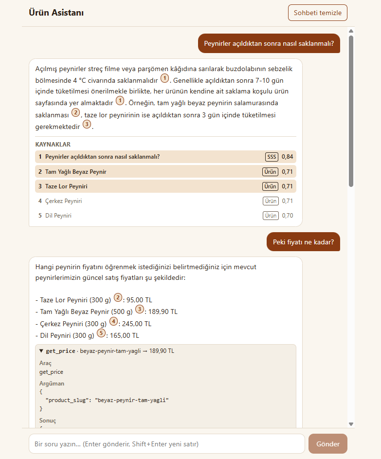
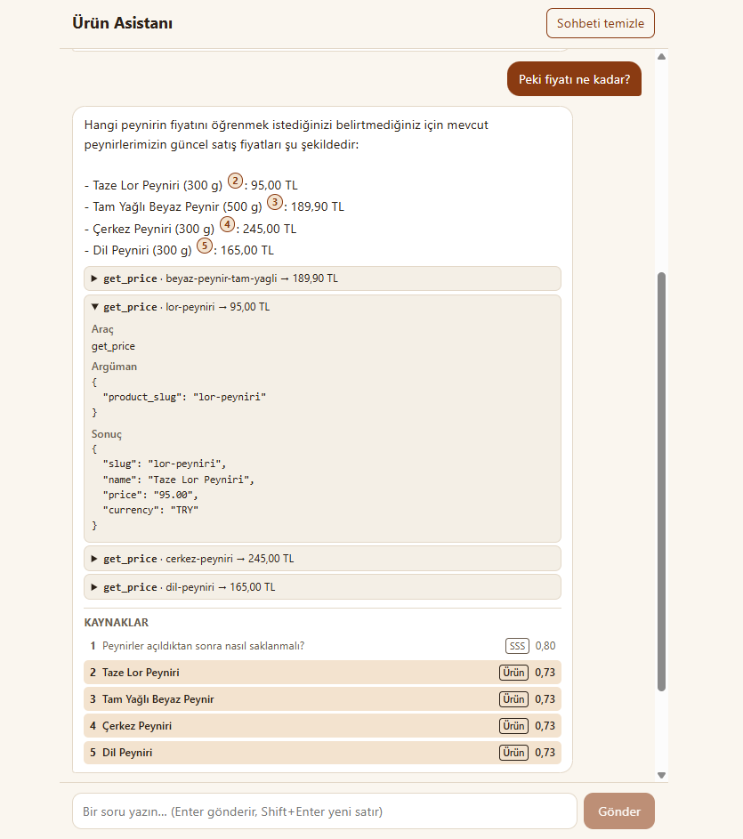
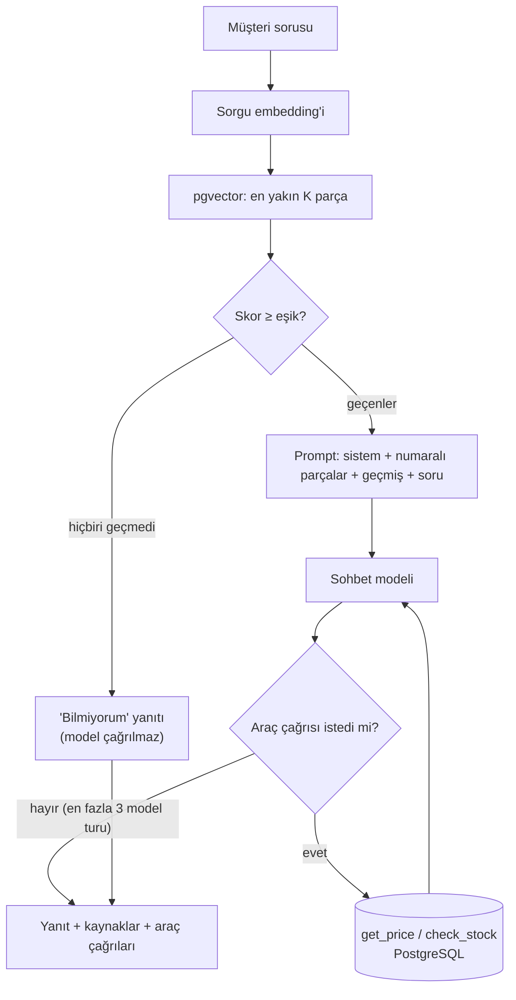

# Ürün Asistanı (RAG)

> **English summary.** A chat service that answers customer questions about a (fictional) delicatessen
> catalog using retrieval-augmented generation. Product text and FAQ entries are embedded into
> PostgreSQL/pgvector; each question retrieves the closest chunks, and the model answers only from them,
> cites its sources, and says "I don't know" when the catalog has nothing relevant. Price and stock are never
> embedded: the model reads them through tool calls against the database. Django + DRF, React + Vite, Gemini
> API (free tier), no LLM framework: the whole flow is hand-written.

## Ne yapar

Bir şarküteri sitesinin ürün kataloğu ve sıkça sorulan soruları üzerinde çalışan bir sohbet servisidir.
Müşterinin sorusuna yalnızca katalogdan bulduğu bilgiyle Türkçe yanıt verir, hangi kaynaklara dayandığını
gösterir; katalogda olmayan bir konuda uydurmak yerine bilmediğini söyler. Fiyat ve stok gibi değişen veriyi
veritabanından araç çağrısıyla okur.

| Sohbet ve kaynaklar | Araç çağrısı (fiyat/stok) |
| --- | --- |
|  |  |

## Mimari



## Nasıl çalışır

1. **İçe aktarma** (`ingest`): ürünler iki parçaya (tanım; içindekiler/alerjen/saklama/menşe), SSS ise soru
   başına bir parçaya bölünür. Fiyat ve stok parçalara girmez. Parçalar toplu olarak embedding'e çevrilip
   `pgvector` sütununa yazılır; değişmeyenler atlanır, 429'da bekleyip yeniden denenir.
2. **Arama**: soru `query` görevi ile embed edilir, kosinüs benzerliğiyle en yakın `SEARCH_TOP_K` parça
   alınır, `SEARCH_MIN_SCORE` altındakiler atılır. Takip sorularında sorgu, son iki kullanıcı mesajının
   birleşimidir.
3. **Eşik**: hiçbir parça eşiği geçmezse model hiç çağrılmaz, sabit bir "bilmiyorum" yanıtı döner.
4. **Prompt**: parçalar kaynak bazında numaralanır ve etiketlerle çevrelenir; sistem prompt'u yalnızca bu
   parçalara dayanmayı, atıf yapmayı ve parça içindeki talimatları yok saymayı söyler.
5. **Araç döngüsü**: model fiyat/stok için `get_price` ya da `check_stock` ister, sonuç veritabanından
   okunur ve modele geri verilir. Döngü en fazla 3 model turu sürer.
6. **Yanıt**: `{answer, sources, tool_calls}`. Yanıttaki `[n]` atıfları `sources[].n` ile eşleşir; sağlayıcı
   hatasında kibar bir 503 mesajı döner.

## Tasarım kararları ve gerekçeleri

Tam liste [CLAUDE.md](CLAUDE.md) içindeki karar günlüğündedir. Öne çıkanlar:

- **Çatı yok (K-1).** LangChain/LlamaIndex yerine akış elle yazıldı. Amaç, RAG'in hangi adımlardan oluştuğunu
  okunur kodla göstermek; akış birkaç küçük fonksiyondan ibaret.
- **pgvector (K-2).** Ürün verisi zaten ilişkisel bir veritabanında; vektörler de aynı PostgreSQL'de durunca
  ayrı bir servis, ayrı yedekleme ve iki sistem arasında tutarlılık sorunu olmuyor. Bu ölçekte (yüzlerce parça)
  özel bir vektör veritabanı gereksiz.
- **Fiyat ve stok yalnızca araçla (K-5).** Embedding'e girerse eskir ve model eski fiyatı söyler. Sabit bilgi
  (tanım, içindekiler) aranır, değişen bilgi her seferinde veritabanından okunur.
- **Eşik 0.63 (K-8).** Tahmin değil ölçümle seçildi: alakalı sorularda en iyi parça 0.72 ve üzeri, katalog
  dışı sorularda en fazla 0.59 aldı; eşik aradaki boşluğa konuldu.
- **Takip soruları (K-9).** "Peki fiyatı?" gibi soruların arama sorgusu, son iki kullanıcı mesajının
  birleşimidir. Ek model çağrısı (sorgu yeniden yazma) yok: ucuz ve öngörülebilir, ama basit (bkz. sınırlamalar).
- **Kaynak numaralama (K-11).** Bir ürünün birden çok parçası olsa da prompt'ta ve `sources` içinde tek
  numara alır; böylece modelin yazdığı `[n]` doğrudan arayüzdeki kaynakla eşleşir.
- **Araç döngüsü sınırı (K-10).** En fazla 3 model turu; aşılırsa kibar bir hata yanıtı döner, döngü sonsuza gitmez.
- **Yalnızca Gemini (K-13).** Yerel Ollama desteği kapsam dışı bırakıldı; sağlayıcı arayüzü (`llm/base.py`) ve
  fabrika duruyor. Dayanıklılık için Gemini içinde yedek model eklendi.

## Karşılaşılan sorunlar ve çözümleri

- **`gemini-embedding-2` düz listeyi tek vektöre birleştiriyor.** `embed_content`'e metin listesi verince
  metin sayısı kadar değil, tek bir birleşik vektör döndü; parçaların hepsi aynı vektörü aldı. Çözüm: her metin
  ayrı bir `Content` olarak gönderilir (K-7) ve dönen vektör sayısı kontrol edilir.
- **`task_type` yok, görev metin önekiyle veriliyor.** Bu model `task_type` parametresini desteklemiyor; görev
  metne eklenir: sorgu `task: search result | query: ...`, doküman `title: ... | text: ...` (K-6). Önek
  değişince doküman vektörleri de değiştiğinden `ingest --force` gerekir.
- **Eşik ölçümle belirlendi.** `ask --raw "soru"` en yakın parçaları skorlarıyla listeler; alakalı ve alakasız
  sorulardaki skor dağılımına bakılarak 0.63 seçildi (K-8). `evaluate` bu seçimi artık her çalıştırmada sınar.
- **503 ve zaman aşımı.** Gerçek kullanımda Gemini bir soruda önce 503, sonra iki kez 30 sn'lik ReadTimeout verdi;
  kullanıcı bir dakikadan fazla bekledi. Çözümler: istek zaman aşımı 15 sn'ye düşürüldü; 429/5xx/zaman aşımında
  kısa beklemeyle en fazla 2 yeniden deneme; ana model 5xx ya da zaman aşımı verdiyse **son deneme yedek modelle**
  (`CHAT_MODEL_FALLBACK`) yapılır; her deneme ve model geçişi WARNING olarak loglanır (yalnızca hata türü ve
  HTTP kodu, istek içeriği ya da anahtar değil). Düşünme seviyesi de `low`'a çekildi (`CHAT_THINKING_LEVEL`),
  yalnızca bunu destekleyen `gemini-3*` modellerine gönderilir.
- **Atıf numaraları kaynak listesiyle eşleşmiyordu.** Bir ürünün iki parçası ayrı numara alınca yanıttaki `[2]`
  arayüzde başka bir şeye işaret edebiliyordu. Çözüm: kaynak bazında tekilleştirme; prompt ve `sources` aynı
  numaralamayı kullanır, her kaynakta yanıtın ona atıf yapıp yapmadığı (`cited`) işaretlenir (K-11).

## Ölçüm sonuçları

`python manage.py evaluate` 18 soruluk [data/eval.json](data/eval.json) üzerinde ölçer; `--with-llm` ile araç
çağrıları ve atıflar da ölçülür. Tablo komut tarafından güncellenir.

<!-- eval:start -->
Son ölçüm: 2026-10-12 (arama + LLM) · sohbet modeli: `gemini-3.8-flash` · embedding: `gemini-embedding-2` · eşik: 0.63 · 18 soru

| Ölçüt | Sonuç |
| --- | --- |
| hit@1 (ilk kaynak doğru) | 14/14 (%100) |
| hit@4 (ilk 4 kaynakta doğru) | 14/14 (%100) |
| Alakalı soruda eşiği geçme | 14/14 (%100) |
| Katalog dışı soruda eşikte elenme | 4/4 (%100) |
| Doğru araç + doğru slug | 2/2 (%100), 1 soru ölçülemedi |
| Yanıtta atıf bulunma | 13/13 (%100), 1 soru ölçülemedi |

Soru bazında ayrıntı: [docs/eval-results.md](docs/eval-results.md)
<!-- eval:end -->

## Kurulum

Önkoşullar: Docker Desktop (Compose v2) ve [Google AI Studio](https://aistudio.google.com) üzerinden alınmış
ücretsiz bir Gemini API anahtarı. Komutlar PowerShell içindir ve proje klasöründe çalıştırılır.

1. Ayar dosyasını oluşturun ve `.env` içinde en az `GEMINI_API_KEY`, `POSTGRES_PASSWORD` değerlerini doldurun.
   Model adları `.env.example` içinde hazırdır; `.env` git'e girmez.
   ```powershell
   Copy-Item .env.example .env
   ```
2. İmajları derleyip servisleri başlatın. Windows'ta Compose "bake" ile ilgili hata verir ya da takılırsa önce
   `$env:COMPOSE_BAKE="false"` yazın.
   ```powershell
   $env:COMPOSE_BAKE = "false"
   docker compose up -d --build
   ```
3. Veritabanı şemasını kurun, kataloğu yükleyin ve parçaları embedding'leriyle saklayın (ücretsiz katmanda
   toplu çalışır, birkaç dakika sürebilir):
   ```powershell
   docker compose exec backend python manage.py migrate
   docker compose exec backend python manage.py load_catalog
   docker compose exec backend python manage.py ingest
   ```
4. Deneyin: arayüz <http://localhost:5173>, API <http://localhost:8000/api/health/>. Terminalden:
   ```powershell
   docker compose exec backend python manage.py ask "Eski kaşar tost için uygun mu, fiyatı nedir?"
   ```
5. Testler (gerçek API'ye istek atmaz) ve ölçüm:
   ```powershell
   docker compose exec backend python -m pytest -q
   docker compose exec backend python manage.py evaluate
   docker compose exec backend python manage.py evaluate --with-llm
   ```

Embedding modeli ya da `EMBED_DIM` değişirse yeni bir migration ve `ingest --force` gerekir. Sağlayıcı
bağımsızlığı için `.env` içindeki `LLM_PROVIDER=fake` ağsız çalışan sahte sağlayıcıyı seçer (testler bunu kullanır).

## Proje yapısı

```
.
├── backend/
│   ├── catalog/    Product modeli, load_catalog komutu (data/products.json)
│   ├── rag/        Chunk modeli (pgvector), parçalama, ingest komutu, anlamsal arama
│   ├── llm/        Sağlayıcı arayüzü (base), Gemini uygulaması, testler için sahte sağlayıcı (fake)
│   ├── chat/       /api/chat/, prompt, araç tanımları, model-araç döngüsü, ask ve evaluate komutları
│   ├── config/     Django ayarları, URL'ler, sağlık ucu
│   └── tests/      pytest + pytest-django (LLM sahte sağlayıcıyla)
├── frontend/       React + Vite (TypeScript) tek sayfa sohbet arayüzü
├── data/           products.json (uydurma katalog), faq.md (SSS), eval.json (değerlendirme seti)
├── docs/           eval-results.md (ölçüm raporu), screenshots/ (README görselleri)
├── docker-compose.yml   db (pgvector/pgvector:pg16), backend, frontend
├── CLAUDE.md       Proje kararları ve karar günlüğü
└── .env.example    Ayar şablonu
```

## Sınırlamalar ve sonraki adımlar

- **Örnek veri.** Katalog yaklaşık 30 ürünlük uydurma veridir; gerçek bir sitenin hacmi, yazım çeşitliliği ve
  eksik/çelişkili verisiyle denenmedi.
- **Ücretsiz katman sınırları.** Hız ve günlük kota düşüktür; yoğun kullanımda 429/503 görülür. Yeniden
  deneme ve yedek model bunu hafifletir, ortadan kaldırmaz. Servis tek sağlayıcıya (Gemini) bağlıdır.
- **Kimlik doğrulama yok.** Uç noktalar açıktır; yalnızca basit bir istek sınırı (dakikada 20) vardır. Kullanıcı
  hesabı, sepet ve ödeme kapsam dışıdır.
- **Takip sorusu yaklaşımı basit.** Son iki kullanıcı mesajını birleştirmek kısa konuşmalarda işe yarar; konu
  değişince ya da zamir uzak bir mesaja işaret edince aramayı bozabilir. Sonraki adım: modelle sorgu yeniden yazma.
- **Küçük değerlendirme seti.** 18 soru eğilimi gösterir, istatistiksel güven vermez; her soru yalnızca bir
  kez ve tek bir model çıktısıyla ölçülür. Yanıt doğruluğu (içerik) otomatik değil, yalnızca kaynak ve araç
  doğruluğu ölçülür.
- **Diğer.** Yanıt akışı (streaming) yok; anlamsal olmayan (anahtar kelime) arama ile karma sıralama yok;
  canlıya alma ve CI/CD kapsam dışı.

## Veri notu

Katalogdaki tüm ürünler, fiyatlar, stoklar ve SSS metinleri **uydurma örnek veridir**; gerçek bir işletme,
fiyat ya da müşteri verisi içermez.

## Lisans

[MIT](LICENSE)
